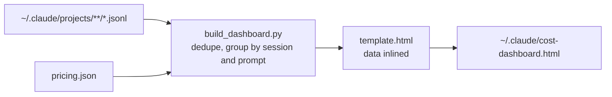

# Cost Dashboard Plugin Implementation Plan

## Goal

Ship a `cost-dashboard` plugin in the `losus-ai` marketplace whose `/cost-dashboard:dashboard`
command builds an HTML dashboard of estimated Claude Code cost per session and per task, using
only local session logs.

## Context

- Claude Code writes one JSONL log per session under `~/.claude/projects/<project>/`; subagent
  transcripts live in `<session>/subagents/`. Assistant records carry `message.usage` token counts.
- Cost is not logged, so it is estimated: tokens × per-model rates in `pricing.json`.
- A "task" is one real user prompt and every assistant call until the next prompt.
- Layout follows the repo convention: `<name>/plugins/<name>/` holds the plugin, with a
  top-level `deploy.zsh`, `uninstall.zsh`, `README.md`, and a `git-subdir` entry in
  `.claude-plugin/marketplace.json`. The plugin is command-only (no rules or hooks).

## Tasks

### Prototype

- [x] Parse session logs and de-duplicate streamed assistant messages
- [x] Aggregate cost per session, task, model, day, and subagent
- [x] Self-contained HTML template (KPIs, daily chart, model table, expandable sessions)
- [x] Verify totals against a hand calculation on synthetic logs

### Repo integration

- [x] Create `cost-dashboard/plugins/cost-dashboard/` with `plugin.json`, command, scripts, `pricing.json`
- [x] Add `deploy.zsh`, `uninstall.zsh`, `README.md`, `LICENSE`
- [x] Add the `git-subdir` entry to `.claude-plugin/marketplace.json`
- [x] Add the plugin to the root `README.md` (table, deploy and uninstall lists)

### Validation and release

- [ ] Run `/cost-dashboard:dashboard` against real logs and sanity-check the totals
- [ ] Verify `pricing.json` rates against current Anthropic pricing
- [ ] Install via `./deploy.zsh` and confirm the command appears as `/cost-dashboard:dashboard`
- [ ] Commit on a `feature/` branch and open a PR

### Enhancements

- [ ] Attribute separate-file subagent cost to the task that spawned it
- [ ] Optional `SessionEnd` hook to refresh the dashboard automatically
- [ ] Per-project grouping view
- [ ] Token-type breakdown per task (input, output, cache write, cache read)

## Open questions

- Should cache-write pricing distinguish 5-minute from 1-hour TTL? The prototype assumes 5-minute.
- Does the log format record fast-mode or batch pricing? The prototype ignores both.

## Exit criteria

- Dashboard totals for a known session match an independent calculation from its raw log.
- Plugin installs from the marketplace on a clean machine and the command runs without edits.
