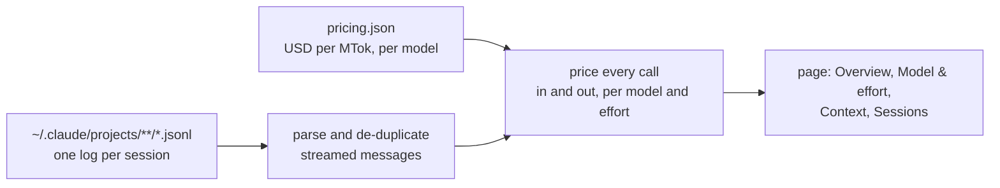
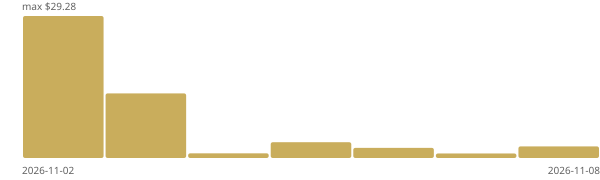
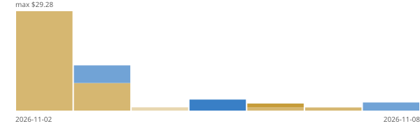
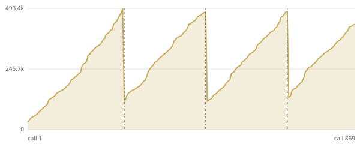

# Cost dashboard: a tab-by-tab walkthrough

This guide explains every tab of the dashboard, what each number means, and how to read it, using a small **made-up** example
(7 sessions, projects `acme-api`, `docs-site` and `infra`) so no real prompts or projects appear here. The figures below are what the dashboard
shows for that example. Open [`example-dashboard.html`](example-dashboard.html) in a browser to click around the same data;
[`make_example.py`](make_example.py) rebuilds it, and the images in [`images/`](images/), from scratch.

- [Concepts you need first](#concepts-you-need-first)
- [Running it](#running-it)
- [The header](#the-header)
- [Overview tab](#overview-tab)
- [Model & effort tab](#model--effort-tab)
- [Context tab](#context-tab)
- [Sessions tab](#sessions-tab)
- [What the numbers are not](#what-the-numbers-are-not)

## Concepts you need first

**Tokens, in and out.** A model reads tokens (**in**) and writes tokens (**out**). Providers price the two sides separately, in USD **per million
tokens (MTok)**, so the dashboard shows tokens in, tokens out, and the dollars for each side (`$ In`, `$ Out`) everywhere. Output is always the
more expensive side per token. For Claude Sonnet 5.5 it is $10 per MTok out against $2 per MTok of fresh input.

**Context.** Every call to the model re-sends the whole conversation: the system prompt, the tool list, every earlier message and every tool result.
That is the call's *context*. A long conversation therefore costs more on every call, not once. The dashboard counts all of it as **in**: fresh
input, cache writes and cache reads.

**Prompt caching.** To make re-sending cheap, the API caches the start of the context. Three prices matter, all as a multiple of the model's input price:

| Part | What it is | Price |
|---|---|---|
| Fresh input | tokens not in the cache | 1x |
| Cache write | tokens stored in the cache for next time | 1.25x for the 5-minute cache, 2x for the 1-hour cache |
| Cache read | tokens served from the cache | a fraction that **depends on the model**: 0.05x for Sonnet 5.5 and Opus 5.5, 0.025x for Fable and Mythos 5.1/5.2, 0.1x for most others |

Because a call re-reads its whole context but writes only what is new, **cache reads usually dominate the bill**, even at a tenth of the price.

**One call, worked out.** A Sonnet 5.5 call with 300,000 tokens of cached context, 2,000 new tokens written to the 1-hour cache, 2 fresh input
tokens and 800 tokens of output costs:

| Part | Tokens | Rate per MTok | Cost |
|---|---:|---:|---:|
| Cache read | 300,000 | $0.10 | $0.0300 |
| Cache write (1h) | 2,000 | $4.00 | $0.0080 |
| Fresh input | 2 | $2.00 | $0.0000 |
| **In** | 302,002 | | **$0.0380** |
| **Out** | 800 | $10.00 | **$0.0080** |
| **Total** | | | **$0.0460** |

The same call on Opus 5.5 ($4 in, $20 out, reads at $0.20, 1-hour writes at $8) costs $0.092, exactly twice as much. Comparing models comes down
to these two columns: dollars in and dollars out.

**Effort.** Claude Code records the effort level of each call (`low`, `medium`, `high`, ...). Effort changes how much a model thinks and writes,
so it only makes sense next to the model it ran on. The dashboard never adds effort up across models: it always shows **model and effort together**.

**Task.** One task is one prompt you typed plus everything Claude did in response, including subagents started in that turn.

**Compaction.** When a conversation nears its limit, Claude Code summarises it and carries on from the summary. See [Context tab](#context-tab).



## Running it

Two ways to run the command (once the plugin is installed):

```
/cost-dashboard:dashboard                  # writes ~/.claude/cost-dashboard.html (last 30 days)
/cost-dashboard:dashboard --days 7
/cost-dashboard:dashboard --project acme   # only sessions whose project or working directory contains "acme"
/cost-dashboard:dashboard serve            # a live page on http://127.0.0.1:8780/ that rebuilds as your logs grow
/cost-dashboard:dashboard serve --port 8770 --days 0
```

The static file is a snapshot. `serve` keeps a small local server running; reload the browser to see new costs. It serves only the page and its
data (`/data.json`), binds to `127.0.0.1`, and refuses requests that name any other host. From another machine, use an SSH tunnel.

## The header

The top-right tile is the headline: **Estimated total** for the period, how many sessions it covers, and the average per session. If a model has
no entry in `pricing.json`, or a call used a premium mode that is not priced (fast mode, a non-standard service tier, or
`inference_geo: us`), a banner under the header says so. Those calls are still counted, at the standard rate, so the total may be low.

Four tabs follow: Overview, Model & effort, Context and Sessions.

## Overview tab

The Overview is the one-minute answer to "what did I spend and where".

**The cards** (example data):

| Card | Example | Meaning |
|---|---|---|
| Sessions | 7 | Sessions with activity in the period |
| Avg / session | $7.46 | Total divided by sessions |
| Tasks (prompts) | 88 | Prompts that Claude answered |
| Avg / task | $0.59 | Total divided by tasks |
| Subagent share | 0% | Share of the cost spent by subagents instead of the main conversation |
| Cache hit rate | 99% | Cache reads as a share of everything sent in (reads + writes + fresh input) |
| Tokens in / out | 272.2M / 934.1k | All tokens sent to the models and all written back |
| Cost in / out | $41.40 / $10.82 | What each side cost |

The example shows the usual shape: about 290 times more tokens go **in** than **out**, yet in costs only about four times as much, because most of the
input is cache reads.

**Cost per day.** Estimated USD per calendar day (your local day); hover a bar for the figure.



**By model.** One row per model with calls, tokens in and out, and the dollars for each side:

| Model | Calls | In tokens | Out tokens | $ In | $ Out | Cost |
|---|---:|---:|---:|---:|---:|---:|
| claude-sonnet-5-5 | 1041 | 252.0M | 779.1k | $33.58 | $7.79 | $41.37 |
| claude-opus-5-5 | 204 | 20.1M | 151.3k | $7.81 | $3.03 | $10.83 |
| claude-haiku-5-5 | 5 | 161.3k | 3.7k | $0.01 | $0.00 | $0.01 |

## Model & effort tab

This tab is for comparing models, and effort levels on the same model.

### Cost by model and effort

A model that ran at **one** effort gets one row, labelled `model · effort`. A model that ran at **several** gets a bold total row with each effort
nested under it, ordered low to high:

| Model / effort | Calls | In tokens | Out tokens | $ In | $ Out | In $ / 1M | Out $ / 1M | Cost | Share |
|---|---:|---:|---:|---:|---:|---:|---:|---:|---:|
| **claude-sonnet-5-5** | 1041 | 252.0M | 779.1k | $33.58 | $7.79 | $0.133 | $10.00 | $41.37 | 79% |
| &nbsp;&nbsp;low | 55 | 2.7M | 42.1k | $0.54 | $0.42 | $0.200 | $10.00 | $0.96 | 2% |
| &nbsp;&nbsp;medium | 947 | 243.5M | 710.3k | $32.14 | $7.10 | $0.132 | $10.00 | $39.24 | 75% |
| &nbsp;&nbsp;high | 39 | 5.8M | 26.7k | $0.91 | $0.27 | $0.156 | $10.00 | $1.17 | 2% |
| **claude-opus-5-5** | 204 | 20.1M | 151.3k | $7.81 | $3.03 | $0.388 | $20.00 | $10.83 | 21% |
| &nbsp;&nbsp;medium | 139 | 14.8M | 99.5k | $5.59 | $1.99 | $0.379 | $20.00 | $7.58 | 15% |
| &nbsp;&nbsp;high | 65 | 5.3M | 51.8k | $2.22 | $1.04 | $0.415 | $20.00 | $3.25 | 6% |
| **claude-haiku-5-5 · medium** | 5 | 161.3k | 3.7k | $0.01 | $0.00 | $0.050 | $0.511 | $0.01 | 0% |

How to read it:

- **`In $ / 1M` and `Out $ / 1M`** are the price actually paid per million tokens on each side. **Out** matches the list price ($10 for Sonnet, $20 for
  Opus), because output has one price. **In** is much lower than the list input price ($2 or $4), because most input was cache reads at $0.10 or
  $0.20. Compare the two models on these columns, not on the list input price.
- On the same effort, Opus cost about 2.9 times as much per million tokens in ($0.379 against $0.132 at medium) and 2 times as much per million out.
- Sonnet at `low` pays $0.200 per million in against $0.132 at medium. Both are about 97-99% cache reads; the difference is cache **writes**: 2.6% of the
  tokens in for the short `low` sessions against 0.8% for the long medium one, and a 1-hour write costs 40 times a read per token ($4.00 against $0.10).
  The per-million rate moves with how much of the context is newly cached, which depends on how long the conversation is, so look at calls and
  tokens before reading anything into the effort level.

### Model x effort

The same figures as a grid. Each cell shows the cost, the tokens in and out, and the dollars in and out; darker cells cost more. A dash means that
model never ran at that effort.

| Model | low | medium | high | Total |
|---|---|---|---|---|
| claude-sonnet-5-5 | $0.96 | $39.24 | $1.17 | $41.37 |
| claude-opus-5-5 | – | $7.58 | $3.25 | $10.83 |
| claude-haiku-5-5 | – | $0.01 | – | $0.01 |

### Cost per day by model and effort

The Overview's daily chart with each bar split by model and effort, at full width above the task table. The colour is the model (gold is Sonnet, blue is Opus) and the shade is the effort
(lighter is lower). The legend lists every model and effort pair that appears.



### Cost per task by model and effort

Each task is filed under the model and effort that cost the most inside it, then averaged. This answers "does a higher effort cost more per prompt
on the same model?". A row with fewer than 5 tasks is marked *small sample*, because a few tasks make a noisy average.

| Model · effort | Tasks | Calls / task | In tokens / task | Out tokens / task | $ In / task | $ Out / task | Cost / task | Total |
|---|---:|---:|---:|---:|---:|---:|---:|---:|
| sonnet-5-5 · low | 14 | 3.9 | 190.9k | 2.9k | $0.03 | $0.03 | $0.06 | $0.84 |
| sonnet-5-5 · medium | 46 | 20.5 | 5.3M | 15.4k | $0.69 | $0.15 | $0.84 | $38.87 |
| sonnet-5-5 · high | 5 | 7.8 | 1.2M | 5.3k | $0.18 | $0.05 | $0.23 | $1.17 |
| opus-5-5 · medium | 17 | 8.1 | 864.4k | 5.7k | $0.30 | $0.11 | $0.42 | $7.08 |
| opus-5-5 · high | 6 | 10.7 | 885.9k | 8.4k | $0.33 | $0.17 | $0.50 | $3.00 |

Calls per task and tokens per task are as telling as the dollars: here the one very long medium-effort Sonnet session drives the high average, which says
more about that conversation's length than about the model.

## Context tab

This tab answers "why does it cost this much?": which kind of token you pay for, what each model charges per million, and how the context grows.

### Where the cost goes

Cost by token type, with the price actually paid per million tokens of each type:

| Token type | Tokens | Cost | Per 1M tokens | Share |
|---|---:|---:|---:|---:|
| Cache read | 269.5M | $28.90 | $0.107 | 55% |
| Cache write | 2.7M | $12.49 | $4.68 | 24% |
| Output | 934.1k | $10.82 | $11.58 | 21% |
| Fresh input | 2.5k | $0.01 | $2.32 | 0% |

Cache reads are the most tokens by far and the largest share of the bill, yet each token is the cheapest. Output is the opposite: few tokens, high price.
The "per 1M tokens" figures are blends over the models in use, so they sit between the individual models' rates.

### Price per 1M tokens

The rate card for every model that appears, straight from `pricing.json`, with the date it was checked against the provider's pricing page:

| Model | Fresh input | Cache write 5m | Cache write 1h | Cache read | Read vs input | Output | Context paid |
|---|---:|---:|---:|---:|---:|---:|---:|
| claude-sonnet-5-5 | $2.00 | $2.50 | $4.00 | $0.100 | 0.05x | $10.00 | $0.133 |
| claude-opus-5-5 | $4.00 | $5.00 | $8.00 | $0.200 | 0.05x | $20.00 | $0.388 |
| claude-haiku-5-5 | $0.100 | $0.125 | $0.200 | $0.010 | 0.1x | $0.500 | $0.050 |

- **Read vs input** is the cache-read fraction. It differs by model; it is not a constant 0.1.
- **Context paid** is what a million tokens of carried context actually cost you, blending fresh input, cache writes and cache reads. It is the honest
  "input price" for your usage, and it is far below the list input price.
- Haiku 5.5 charges higher rates for prompts over 100k tokens; the page says so next to the model, and the tier is applied per call.
- The note under the table also says how much of your cache writing used the 1-hour cache. Claude Code uses it a lot, and it costs 2x input
  where the 5-minute cache costs 1.25x.

### Context carried per call

Pick a session and the chart shows the tokens sent to the model on each call of the main conversation: fresh input plus cache writes plus cache reads.
Subagents carry their own context and are not drawn. Example (the long `acme-api` session, 869 calls):



> 869 calls. Average 274.8k tokens, peak 493.4k, last 428.5k. 3 drops to under 70% of the call before (dashed lines).

**Why a sawtooth.** Every call adds to the context (tool output, files read, the model's own replies), so the line climbs. At a limit Claude Code
**compacts** the conversation: it asks the model to summarise it, which takes a minute or two, and continues from the summary. The summary is small
(roughly 25-30k tokens), so the line falls off a cliff and starts climbing again.

**What the dashed lines are.** The dashboard draws a dashed line wherever the context falls to under 70% of the call before. That rule cannot tell a
compaction from a `/clear`; it reports "a drop". In a real log of this kind (a long multi-day session) all five drops were **automatic compactions**:
the log has a `compact_boundary` record with `trigger: auto` at each one.

| Context before | After the summary | Time to summarise |
|---:|---:|---:|
| 494k | 23k | 85 s |
| 969k | 32k | 93 s |
| 471k | 23k | 66 s |
| 465k | 23k | 87 s |
| 968k | 29k | 87 s |

Three fired at roughly 465-494k and two at roughly 968k; the limit was not the same each time (probably a different context-window setting
at the time, which the log does not say).

**The dashed lines are not the 1-hour cache.** The cache changes what a call *costs*, not how large its context is, so a cache expiring leaves no
mark on this chart. Two cache facts are visible in the logs, though:

- The first call after a compaction **writes about 85-97k tokens** to the cache (the new summary) and reads only about 28k (the system prompt and tools).
  At the 1-hour write price for Sonnet 5.5 that is about $0.35, a one-off.
- Several compactions came after long idle gaps (3 to 8 hours), far past the 1-hour cache lifetime, so the cache had expired by then anyway.

A cold cache shows up in the data as a call whose **cache write is large and cache read small**. The chart does not mark those yet.

**Reading the cost off the shape.** Cost per call is roughly the height of the line times the price per cached token, so a session spends most of its money
at the top of each tooth. Compacting earlier, starting a fresh session for a new task, and moving noisy work into subagents (which have their own, smaller
context) all flatten the teeth.

### Context by session

| Session | Calls | Avg context | Peak | Resets | Cache hit | Avg output / call | Cost |
|---|---:|---:|---:|---:|---:|---:|---:|
| acme-api · Split the settings module into two files | 869 | 274.8k | 493.4k | 3 | 99% | 749 | $37.40 |
| acme-api · Write the migration for the orders table | 88 | 126.0k | 219.7k | 0 | 98% | 715 | $5.19 |
| acme-api · Find the slow query in the report endpoint | 65 | 82.2k | 147.0k | 0 | 97% | 797 | $3.25 |
| infra · Write the migration for the orders table | 51 | 71.8k | 118.7k | 0 | 97% | 717 | $2.39 |

Click a row to draw that session above. *Resets* counts the dashed lines. A session with a high average context and many calls is where the money went;
a high cache hit rate with a large context means you are paying the cheap read price on a lot of tokens.

## Sessions tab

One row per session. It starts compact, and you open up what you want.

**Table or Graph.** Two buttons beside the search box switch the tab between the table below and a graph of cost per calendar day,
stacked by model (the same colour for a model as in the other charts). The graph covers every session the search lets through, not only the
page the table shows, so searching `sonnet` or a project name shows that slice's trend. Days with no cost still get a slot, so a quiet
week reads as a gap. The legend gives each model's total for the period, and hovering a segment shows the day, the model and its cost
beside that day's total. The choice is kept in the address (`?view=graph`), so a link opens on the graph.

**Collapsed (the default)** shows Last active, **Project ▸**, Model · effort, Tasks, Calls, In tokens, Out tokens, `$ In`, `$ Out`, Subagent and Cost:

| Last active | Project ▸ | Model · effort | Tasks | Calls | In tokens | Out tokens | $ In | $ Out | Subagent | Cost |
|---|---|---|---:|---:|---:|---:|---:|---:|---:|---:|
| 2026-11-03 10:21 | acme-api | sonnet-5-5 · medium | 34 | 869 | 238.8M | 651.2k | $30.89 | $6.51 | $0.00 | $37.40 |
| 2026-11-03 13:30 | acme-api | opus-5-5 · medium | 10 | 88 | 11.1M | 62.9k | $3.93 | $1.26 | $0.00 | $5.19 |
| 2026-11-05 10:53 | acme-api | opus-5-5 · high | 6 | 65 | 5.3M | 51.8k | $2.22 | $1.04 | $0.00 | $3.25 |
| 2026-11-08 12:03 | infra | opus-5-5 · medium | 7 | 51 | 3.7M | 36.6k | $1.66 | $0.73 | $0.00 | $2.39 |
| 2026-11-06 12:15 | docs-site | sonnet-5-5 · high +2 | 9 | 79 | 8.2M | 57.3k | $1.55 | $0.54 | $0.01 | $2.09 |

- **Model · effort** shows the model and effort pair that cost the most in the session. `+2` means two other pairs were also used (here, the same model
  at another effort and a Haiku subagent).
- **Subagent** is the part of the cost spent by subagents. **In** and **Out** are tokens; `$ In` and `$ Out` their cost.
- Last active is shown in UTC; the per-day charts use your local day.

**Project ▸ and First prompt.** The first prompt makes the table very wide, so it is folded into the Project column. Click the **▸** next to Project to
split it into **Project** and **First prompt**; the table then scrolls sideways. Click **◂** to fold it back. Clicking the word "Project" still sorts.

| Last active | Project ◂ | First prompt | Model · effort | Tasks | ... |
|---|---|---|---|---:|---|
| 2026-11-03 10:21 | acme-api | Split the settings module into two files | sonnet-5-5 · medium | 34 | ... |
| 2026-11-03 13:30 | acme-api | Write the migration for the orders table | opus-5-5 · medium | 10 | ... |

**Other controls.**

- **Expand a session.** Click a row (or focus it and press Enter) to list its tasks, costliest first. Each task row has its own model and effort, calls, tokens and cost.
  While First prompt is folded away, a task's prompt appears in the Project column, cut short, with the full text on hover.
- **Sort.** Click any header. Click again to reverse. Sorting returns you to page 1.
- **Search.** Matches project, first prompt, model and effort.
- **Pages.** 10 rows per page by default; choose 10, 25, 50 or 100. A footer shows "1-7 of 7", the page, and Previous / Next.

## What the numbers are not

- **They are estimates.** The dashboard multiplies token counts by the rates in `pricing.json`. It is not a bill. On a subscription plan (Pro or Max) the
  numbers are the API-equivalent value of your usage, not what you pay.
- **Rates come from the provider's pricing page** and carry the date they were checked (shown on the Context tab). When prices change, edit
  `pricing.json` and its `verified` date. A model with no entry is priced at a fallback rate and flagged.
- **Not priced, only flagged:** fast mode, batch processing and `inference_geo: us` (a 1.1x multiplier). Those calls are counted at the standard rate.
- **Subagents in separate files** count in the session total and the Subagent column but cannot always be tied to the task that started them, so the
  per-task figures can be a little lower than the session total.
- **Effort is read from the logs.** If a call has no effort recorded it is filed under `unknown`.

## Regenerating the example

```
python3 cost-dashboard/guide/make_example.py            # rebuilds example-dashboard.html and images/*.svg
python3 cost-dashboard/guide/make_example.py --tables   # also prints the tables as text
```

The sample logs are invented and seeded, so the output is the same every time. The images are taken from the page's own script (run under `node`), so they show
what the dashboard draws.
