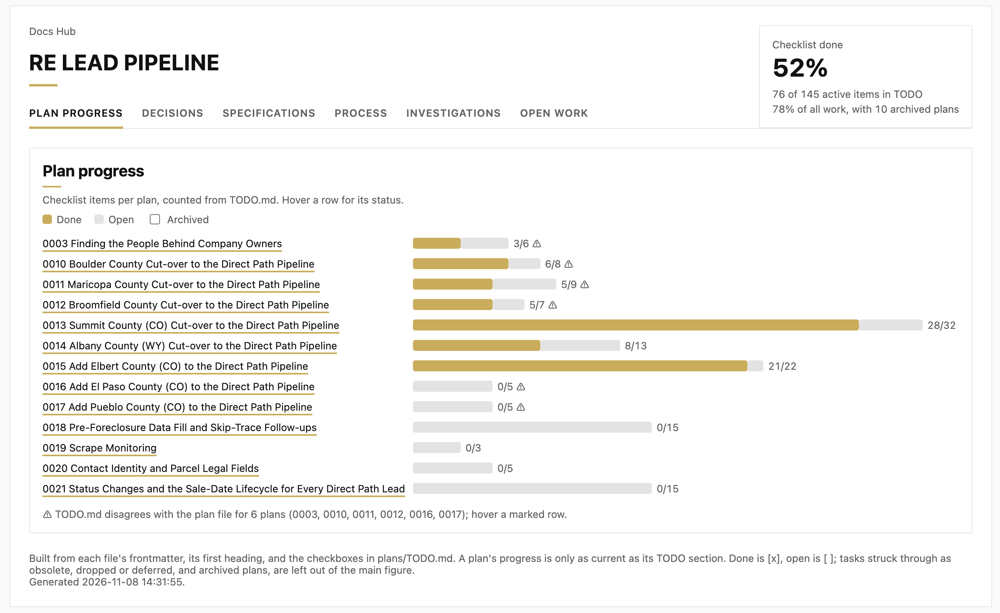

# docs-hub

[](LICENSE)

**Author:** Mark Susol

The `/docs-hub:hub` command — builds a single hub page (`docs/.hub/index.html`) for a repo that uses
the planning-docs layout (`adr/`, `plans/` with `TODO.md`, `investigate/`), or serves it with live
rebuilds. Plans, decisions, specs, process docs and investigations on one page, with the progress of
every plan counted from its checkboxes.



*The Plan progress tab on a project in progress (generated 2026-11-08): one bar per plan counted from
`plans/TODO.md`, the headline tile (done ÷ done + open over the active plans), and ⚠ on the plans whose
`TODO.md` section disagrees with the plan file.*

## Why

Plans, decisions and investigations pile up as markdown across `docs/`, and nobody can see at a glance
what is done, what is open, and which plan's checklist has drifted from its `TODO.md`. The hub reads the
files you already keep and shows that, without a database or a build step.

## What it shows

| Tab | From |
|---|---|
| Plan progress | the checkboxes in `plans/TODO.md`, one section per plan; a plan with no section falls back to its own checklist |
| Decisions | `adr/` (status, date) |
| Specifications | `specs/` |
| Process | `process/` |
| Investigations | `investigate/` |
| Open work | every open task, with "Include done" to widen it |

It also checks that `TODO.md` mirrors each plan file task for task (⚠ on a plan whose done and open
counts differ) and flags a "Next steps" item whose date has passed.

## Use

```zsh
python3 plugins/docs-hub/scripts/build_hub.py docs            # build once
python3 plugins/docs-hub/scripts/build_hub.py docs --watch    # rebuild on change
python3 plugins/docs-hub/scripts/serve_hub.py docs            # serve it, rebuilt on request
```

In Claude Code: `/docs-hub:hub`, `/docs-hub:hub serve`, `/docs-hub:hub serve <project>`, or
`/docs-hub:hub serve all <projects-dir> --port 8766`. How the numbers are counted, the sync check and
the options are in [the plugin's README](plugins/docs-hub/README.md).

## Installation

```zsh
./deploy.zsh
```

Or manually:

```zsh
claude plugin marketplace add msusol/claude-code-plugins
claude plugin install docs-hub@losus-ai
```

## Updating

Edit the files under `plugins/docs-hub/` and push, then run `claude plugin marketplace update` or
re-run `./deploy.zsh` on each machine. A change to this README, the license or the images does not need a
version bump; a change under `plugins/` does.

## Tests

```zsh
python3 -m unittest discover -s docs-hub/tests -v     # from the repo root; the tile math needs node
```

## License

MIT. See [LICENSE](LICENSE).
